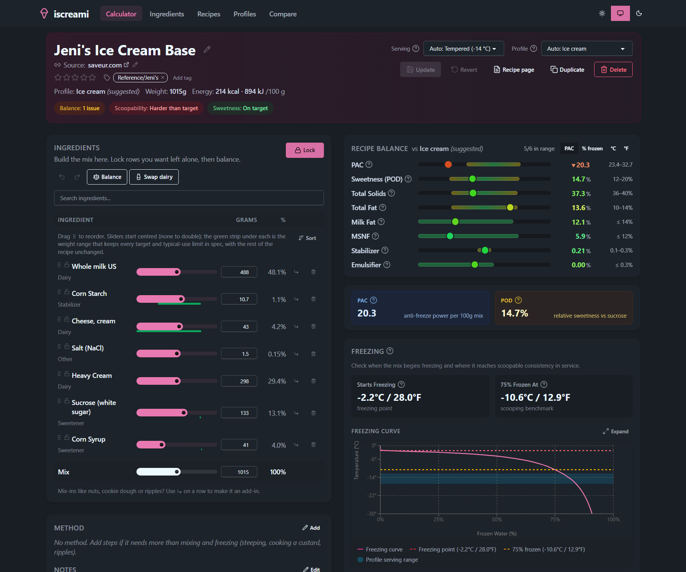

# iscreami — Ice Cream Recipe Calculator

Open-source ice cream recipe formulator. Add ingredients and get real-time feedback on freezing properties, sweetness, composition, and nutrition.

> **This is a fork** of [hadleyrich/iscreami](https://github.com/hadleyrich/iscreami), extended for
> home use with the Ninja Creami and for high-protein, low-calorie recipes. Everything upstream does
> still works; the additions are listed under [What this fork adds](#what-this-fork-adds).
> Like upstream, it is early-stage software: expect rough edges.

<a href="docs/screenshot-calculator.png" target="_blank" rel="noopener noreferrer">
	
</a>

## What it does

- **Recipe calculator** - build a recipe ingredient by ingredient; metrics update live as you type
- **PAC (Potere AntiCongelante)** - measures freezing point depression so you know how hard your mix will freeze
- **Freezing curve** - visualises frozen water % vs. temperature across the serving range
- **POD (Potere Dolcificante)** - relative sweetness vs. sucrose, with a per-ingredient breakdown
- **Nutrition facts** - per 100g and per serving, energy in kcal and kJ
- **Target profiles** - compare your recipe against reference ranges for each style
- **Ingredient library** - 46 seeded ingredients; import more from USDA or the NZ Food Composition Database

## What this fork adds

### Formulating

- **Serving methods** - freezing is judged at the temperature you actually eat it: Creami ice cream
  spin (-9 °C) and lite spin (-7 °C), fresh from the churn, soft serve, gelato case, tempered and
  straight-from-the-freezer, or a custom temperature. Creami windows (53-67% frozen) are calibrated
  on real pints.
- **Styles (target profiles)** - Ice cream, Super-premium ice cream, Gelato, Low-fat, High-protein,
  Sherbet and Sorbet. Sherbet and sorbet follow the US standards (21 CFR 135); dairy minimums are
  judged. A recipe with no profile chosen is matched to the one it fits best, shown as "(auto)".
- **Stabilizer and emulsifier targets are advisory** - shown, but they don't fail a recipe or steer
  the balancer much, since one gum can be ten times as strong as another. Ranges assume pure gums,
  not commercial blends.
- **Balancer** - finds the smallest changes that bring a recipe into its targets, leaving locked rows alone.
- **Swap dairy** - rebuild a recipe's milk, cream and milk powder (skim or whole) from what you have
  on hand, keeping the same weight, fat and milk solids.
- **Sliders with typical-use bands** - each ingredient shows its usual range and warns when you go past it.
- **Add-ins** - ingredients folded in after freezing, kept out of the mix calculations.
- **Undo and redo**, drag-to-reorder rows, and a batch-size slider.

### Model accuracy

- **Milk salts counted once**, by sodium, so whey and milk protein isolates don't read softer than they freeze.
- **Fibres and starches** (inulin, FOS, polydextrose, starch) have realistic anti-freeze values and energy.
- **Chocolate hardening correction** - cocoa butter and cocoa solids firm a mix up (applied at half
  the textbook strength, which matches real results better).
- **Sweeteners** - built-in sucralose and stevioside, alongside the sugars and polyols.
- **USDA import** covers Foundation and SR Legacy foods, with milk solids and lactose estimated for
  dairy. Search ranks your own ingredients above bulk imports.

### Recipes

- **Tags with sub-tags** (e.g. `Status/Testing`), search, sort, and a style filter.
- **Star ratings** in half stars, set from the recipe itself.
- **Duplicate** a recipe as a variant linked to the original.
- **Batch log** - record each time you make a recipe and how it came out. Each entry keeps a copy of
  the recipe as it was, so later edits don't rewrite history.
- **Compare** two recipes side by side.
- **Notes, method and source link** on every recipe.
- **Recipe page** for printing, following on a phone while you cook, or exporting to Paprika
  (`.paprikarecipe`, and embedded schema.org data).
- **Reference recipes** - a set of well-known published recipes, tagged as such, for checking the model against.

### Phone use

- Mobile layout throughout.
- On touch screens the calculator opens **locked**, so scrolling past a slider can't change the recipe;
  tap **Edit** to unlock and **Lock** when done.

## Why it exists

There are a few ice cream recipe calculators out there, but none (that I found) that were open-source and self-hostable. I wanted to build something that I could run locally, customize, and contribute to.

Currently designed for a single/shared user i.e. no authentication implemented. Run it locally or on
a private network (a VPN or ZeroTier/Tailscale); **don't expose it to the internet.**

## About the name

**iscreami** is a mashup of "is it creamy?" and "ice-cream"

Pronounce it as you wish - "is-creamy", "ice-creamy".

## AI Involvement

Portions of this app were developed with AI assistance (Claude / GPT / Copilot), under human developer oversight.
AI was used for both code generation and some design decisions. You can call it vibe-coded, though I do not consider it fully AI-generated.
The project is based on similar work I have written in the past, and all code is human-reviewed and tested.

The fork's additions were written largely with Claude Code, directed and tested by hand.

## Running it

Requires PostgreSQL and is served from a single Docker container. The easiest way is Docker Compose
with a Postgres container alongside. Clone this repo, then next to it create `compose.yaml`:

```yaml
services:
  db:
    image: postgres:17
    restart: unless-stopped
    environment:
      POSTGRES_USER: iscreami
      POSTGRES_PASSWORD: ${POSTGRES_PASSWORD:?set in .env}
      POSTGRES_DB: iscreami
    volumes:
      - pgdata:/var/lib/postgresql/data
    healthcheck:
      test: ["CMD-SHELL", "pg_isready -U iscreami"]
      interval: 5s
      retries: 10

  app:
    build: ./iscreami
    restart: unless-stopped
    environment:
      DATABASE_URL: postgresql+psycopg://iscreami:${POSTGRES_PASSWORD}@db:5432/iscreami
      SERVING_SIZE_G: "100"
    ports:
      - "127.0.0.1:8000:8000"   # add e.g. "<vpn-ip>:8000:8000" to reach it from your phone
    depends_on:
      db:
        condition: service_healthy

volumes:
  pgdata:
```

and a `.env` with `POSTGRES_PASSWORD=<something random>`. Then:

```bash
# First run, and after each upgrade: create/upgrade the schema and seed
# categories, profiles and ingredients. Idempotent: safe to re-run.
docker compose run --rm app sh -c "python -m cli.main db upgrade && python -m cli.main seed all"

docker compose up -d
```

Open **http://localhost:8000** in your browser.

To update after pulling new commits: `docker compose up -d --build`, then run the upgrade step above
if the update includes database changes.

### Without Compose

```bash
cp .env.example .env
# Set DATABASE_URL in .env

docker build -t iscreami .
docker run --rm --env-file .env iscreami \
  sh -c "python -m cli.main db upgrade && python -m cli.main seed all"
docker run --env-file .env -p 8000:8000 iscreami
```

`DATABASE_URL` must be reachable from inside the container (e.g. `host.docker.internal` on Docker
Desktop, or a database container on the same Docker network); `postgresql+psycopg://` is the
expected scheme.

### Importing ingredients

```bash
docker compose run --rm app python -m cli.main import --help
```

The USDA importer takes the FoodData Central bulk downloads (Foundation and SR Legacy).

For local development without Docker, see [CONTRIBUTING.md](CONTRIBUTING.md).

## Contributing

See [CONTRIBUTING.md](CONTRIBUTING.md) for setup instructions, the development workflow, and links to the backend/frontend developer guides.
Changes of general use may be offered upstream to [hadleyrich/iscreami](https://github.com/hadleyrich/iscreami).

## License

Licensed under the GNU Affero General Public License v3.0 (AGPL-3.0). See [LICENSE](LICENSE) for details.
